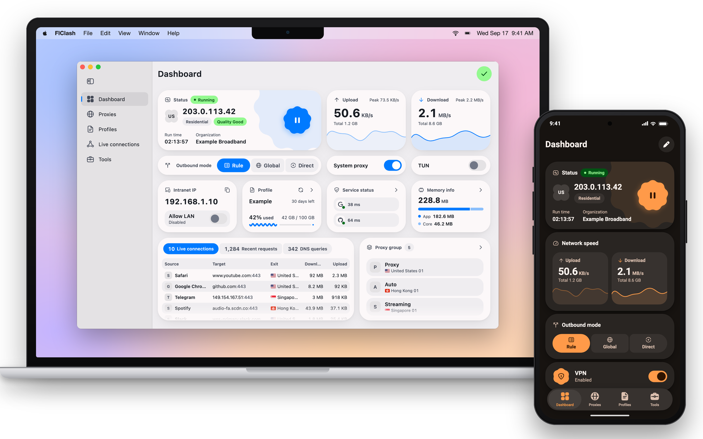

> XClient private development fork, checked on 2026-11-12. Latest status: the redesigned branded UI (sign-in, launch, shell, home, nodes, store, checkout, account, update and exit screens) is rendered on a real Android API35 emulator and a real Windows process; on API35 the SAFE example passed the full normal lifecycle (consent, sign-in, empty form, Home/Back, Activity replacement on one main isolate, explicit Quit) and the native installer component (system unknown-sources toggle, PackageInstaller update, cross-version secure store). Example-brand CI (build, analysis, upstream and XClient tests, Go race, PHP vectors, three desktop/mobile SAFE builds) passes on a public CI mirror while private Actions is blocked by the spending limit. VPN/TUN background, real accounts, real brand packages and production remain unverified; see REQUIREMENTS.md.
>
> Previous check (2026-11-05): Read `REQUIREMENTS.md` first and local `HANDOFF.md` when available. Installation,system confirmations and current acceptance scope: [中文安装与内测指南](INSTALLATION.md). The protocol is [lib/xboard/DESIGN.md](lib/xboard/DESIGN.md); module and build entry points are [lib/xboard/README.md](lib/xboard/README.md) and [tool/xclient/README.md](tool/xclient/README.md).
>
> Branded mode uses Xboard accounts, encrypted managed subscriptions, account/purchase screens, signed API/OSS discovery, independent push, restriction notices, sparse probes, regional recovery and signed updates. Internal failure monitoring works with the default error log level while the UI respects the user's error/silent setting. Changing recovery settings invalidates old in-flight results and later route hops; it cannot recall an already sent native RPC. Managed builds use a pinned nine-line Mihomo carrier, retaining the original submodule revision and ordinary no-tag behavior.
>
> Latest broad local check:617 tests passed with30 conditional skips;the new branded NoView native-event/recovery group passed4/4 separately. Full analysis found no issues,and24 changed Dart files passed read-only formatting. Root independently reran137 critical lifecycle/stop/Core/DIRECT regressions and the4 branded event cases,plus14 engine-owner and4 stop-proof JVM tests. Real isolated tests cover account/orders,encrypted SSRL output and JSONL compatibility,40 HTTPS push streams,API/OSS migration and cache recovery. A real Core/Dart loopback fixture proves default-error failures switch to a same-region node and subsequent HTTP traffic actually uses it. These are component and integration results;physical-node and whole-App background acceptance remain pending.
>
> Full baseline CI41801669779/source9356ec1 passed all7 jobs,including API37/AAR,103 Android JVM tests,complete upstream/XClient tests,analysis,desktop builds and Linux Go/race/real TLS/recovery. Previous three-brand CI41748568822 built all Android3-ABI,Windows and macOS-universal packages;their signed facts,hashes,APK certificates/flags and21 MachO files were independently checked. C35 refresh41837661746/source018cbeb completed23 jobs successfully with publish skipped;its actual files independently passed3 signatures,21 checksums,15 signed asset bindings,9 APK metadata/signature/all90 native-ELF checks and21 universal MachO checks. The three Windows installers have Authenticode status NotSigned. Installation and distribution acceptance remains pending. Manual builds publish private artifacts only.
>
> Windows actual update41771770643 passed Inno installation,production handoff,restart,registry/files/versions and cross-version synthetic secure storage,with owned-process/install/network cleanup. SAFE Windows login/form/password and wide/narrow frames were inspected;interactive UAC remains untested. Mac strict TLS41779064447 passed. Shipping-ad-hoc SAFE update41851246018/sourcefb0cead then passed a real nonce-owned-Keychain system confirmation:one verified AlwaysAllow action,actual bundle update/relaunch,cross-version synthetic read/replace/delete,production exit and exact state/material/process/install/network cleanup. Root inspected the native pre-input dialog PNG and action/cleanup receipts.110 Mac guards pass. No original-login password was accessed and no Accessibility permission was requested. This establishes an interactive controlled update for one synthetic item on the CI host architecture;it does not prove unattended original-login compatibility,all real session keys or installation of the three branded packages. The same-certificate control41819500600 remains a separate no-dialog/red-action result.
>
> Visible Android Quit is available before login and in settings,with47 regressions and inspected320px frames. Actualnormal-main41868452571/source2f274e6 passed real consent,Chinese login,empty-form validation,Home/Back reopen with the same AppPID,71freshXML reads,and owned-process/install/network cleanup;root inspected the native frames. Lifecycle stopped before any replacement or Quit because the VM announcement was unavailable. A narrower owned-PID announcement query retains16KiB/authenticated-localhost/getVM checks;128Python guards pass,but actualVM/lifecycle/Quit acceptance remains pending. The separate SAFE paired-APK native-installer/store component is implemented and locally reviewed;run41871377423/source95e9eea got no runner because GitHub reported a payment/spending-limit problem. Restore Actions before further actual CI. No active-VPN,Doze,real-account or user acceptance is claimed.
>
> The existing production API path still has a public HTTP backhaul hop and private-GitHub update URLs that clients cannot read anonymously. Strict TLS/Web origins,initial rescue resources and readable signed package mirrors must be deployed before formal real-account use;production changes require separate authorization. Source and brand repositories are private by user instruction. Only the example brand belongs here;real endpoints/artwork stay in the private brand repository and signing secrets stay in local secret storage/CI secrets. Detailed operational evidence remains local. Upstream FlClash documentation follows below.

<div align="center">


# FlClash

A multi-platform proxy client based on ClashMeta. Simple to use, open source and ad-free.

**English** · [简体中文](README_zh_CN.md)

[](https://github.com/chen08209/FlClash/releases/latest)
[](https://github.com/chen08209/FlClash/releases)
[](LICENSE)
[](https://t.me/FlClash)

[Website](https://chen08209.github.io/FlClash) · [Download](#download) · [Changelog](CHANGELOG.md) · [Build from source](#build-from-source)

</div>

<p align="center">
  <picture>
    <source media="(prefers-color-scheme: dark)" srcset="snapshots/preview-dark.png">
    
  </picture>
</p>

## Features

- **One app for Android, Windows, macOS and Linux**, with x64 and ARM64 builds on the desktop.
- **mihomo (Clash.Meta) core** with rule routing, proxy groups, latency tests, system proxy and TUN mode.
- **Profiles** from a subscription link or a file, with a built-in editor, override scripts, and custom rules,
  proxies and proxy groups.
- **Live views** of connections, requests, DNS queries and logs.
- **Material You design with Apple-style interaction**: dynamic color, light and dark themes, continuous corners,
  sheets that snap between heights, and layouts that adapt from phones to desktops.
- **Backup and restore** through WebDAV or a local file.
- **Platform touches**: a Quick Settings tile, per-app proxy and Android TV support on Android; a tray menu and
  global hotkeys on the desktop.
- **Open source and ad-free**, licensed under GPL-3.0.

## Download

Get the latest build from [GitHub Releases](https://github.com/chen08209/FlClash/releases/latest), or open the
[website](https://chen08209.github.io/FlClash#download), which picks the right file for your device.

| Platform | Packages | Notes |
| --- | --- | --- |
| Android | APK for `arm64-v8a`, `armeabi-v7a` and `x86_64` | Most phones use `arm64-v8a`. Also on the F-Droid repository below. |
| Windows 10 and later | Installer (`.exe`) or portable `.zip`, for x64 and ARM64 | Pick ARM64 on Snapdragon and other ARM laptops. |
| macOS 12 and later | DMG for Apple Silicon and Intel | Also on Homebrew. |
| Linux | `.deb`, `.rpm` and AppImage, for x64 and ARM64 | See the tray note below. |

<p>
  <a href="https://chen08209.github.io/FlClash-fdroid-repo/repo?fingerprint=789D6D32668712EF7672F9E58DEEB15FBD6DCEEC5AE7A4371EA72F2AAE8A12FD"></a>
  <a href="https://github.com/chen08209/FlClash/releases/latest"></a>
</p>

**Homebrew**

```bash
brew tap chen08209/tap
brew install --cask flclash
```

**Linux tray icon**

The `.deb` package installs its own dependencies. With the AppImage or the `.rpm`, install the AyatanaAppIndicator
library so the tray icon can show:

```bash
sudo apt-get install libayatana-appindicator3-1   # Debian and Ubuntu
sudo dnf install libayatana-appindicator-gtk3     # Fedora
```

**Unattended desktop**

FlClash starts the core only after the disclaimer is accepted. Where nobody can click it, such as a container, set
`FLCLASH_ACCEPT_DISCLAIMER=1` in the app's environment to accept it on first launch.

## Usage

**Import a profile from a link.** Opening a link in this form imports the subscription into FlClash. The `clashmeta://`
and `flclash://` schemes work the same way.

```text
clash://install-config?url=<URL-encoded subscription link>
```

**Automate on Android.** Tasker, MacroDroid and similar apps can start, stop or toggle the proxy by starting an
activity with one of these actions:

```text
com.follow.clash.action.START
com.follow.clash.action.STOP
com.follow.clash.action.TOGGLE
```

From a computer, the same works over adb:

```bash
adb shell am start -a com.follow.clash.action.TOGGLE
```

## Build from source

You need [Flutter](https://docs.flutter.dev/get-started/install) 3.47 (release builds use 3.47.6),
[Go](https://go.dev/dl/) 1.27 and [Rust](https://rustup.rs/) installed through rustup. Each platform builds on its own
host, except Android, which builds anywhere.

```bash
git clone --recursive https://github.com/chen08209/FlClash.git
cd FlClash
flutter pub get
dart setup.dart android   # or windows, macos, linux
```

Packages land in `dist/`. The Go core and the Rust libraries are compiled as part of the Flutter build.

| Platform | Also needed |
| --- | --- |
| Android | Android SDK with the NDK. Add `--arch arm64` to build a single ABI. |
| Windows | GCC (MinGW-w64) for the core and [Inno Setup](https://jrsoftware.org/isinfo.php) 6 for the installer. |
| macOS | Xcode and Node.js. The script installs `appdmg` through npm. |
| Linux | Debian or Ubuntu. The script installs the build packages with apt and downloads `appimagetool`. |

Run `dart setup.dart --help` for the remaining options, such as `--targets` to build only some package formats.

## Support

Starring the repository is the easiest way to support the project. Questions and announcements go to the
[Telegram channel](https://t.me/FlClash); bugs and feature requests go to
[GitHub Issues](https://github.com/chen08209/FlClash/issues).

<a href="https://star-history.com/#chen08209/FlClash&Date">
  <picture>
    <source media="(prefers-color-scheme: dark)" srcset="https://api.star-history.com/svg?repos=chen08209/FlClash&type=Date&theme=dark">
    
  </picture>
</a>

## License

FlClash is released under the [GPL-3.0 license](LICENSE).
